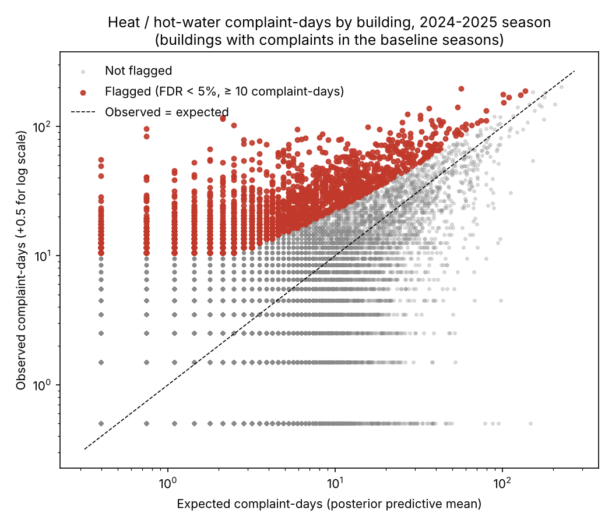

# NYC Heat & Hot-Water Complaint Anomalies

[](https://github.com/jarvissimms12/nyc-heat-anomalies/actions/workflows/tests.yml)


Finding NYC buildings whose heat and hot-water complaints in a heating season are
far above what their own history predicts, using public NYC 311 data.

**Author:** Jarvis Simms · [LinkedIn](https://www.linkedin.com/in/jarvis-simms-846062136/) · [GitHub](https://github.com/jarvissimms12)



*Real 311 data, 2024-25 heating season. Each point is a building with complaints in
the three prior seasons. Red points are flagged: significant at a 5% false discovery
rate and with at least 10 complaint-days.*

## Results (2024-25 heating season)

Data pulled November 15, 2026: **1,000,706** heat/hot-water service requests from
October 2021 through May 2025 (four heating seasons).

**Data quality.** No duplicates, unparseable dates or impossible close dates
were found. **4,543 records (0.45%)** had no valid BBL and could not be tied to a
building, so they were dropped. 23 had coordinates missing or outside NYC and were
flagged but kept. **996,163 records** were loaded.

**Citywide trend.** Complaints rose from 233,363 in 2023-24 to 279,256 in 2024-25
(+20%). Complaint-days rose from 157,777 to 185,003, and about 79% of that increase
(21,481 complaint-days) came from buildings with no complaints in the prior three
seasons. Buildings with a history were only 6% above their own three-season
average. The model adjusts for that 6% so a citywide shift doesn't flag every building.

**Flagged buildings.** Of 67,383 buildings scored:

| | Buildings |
|---|---|
| Flagged, with a complaint history | **1,908** (3.4% of 56,465) |
| Flagged, new to 311 (no complaints in prior 3 seasons) | 185 (reported separately) |

The 1,908 flagged buildings with a history had a median of **21 complaint-days**
against an expected 4.2, about **4.7x** their own baseline. Together they account
for **32.5%** of all complaint-days among buildings with a history.

| Borough | Flagged | Share of borough's buildings |
|---|---|---|
| Bronx | 698 | 5.8% |
| Manhattan | 464 | 4.0% |
| Brooklyn | 490 | 2.5% |
| Queens | 246 | 2.1% |
| Staten Island | 10 | 0.7% |

The most extreme cases went from a handful of complaint-days a season to more than
100. For example, one Queens building averaged 2 complaint-days a season over the
prior three seasons and had 116 in 2024-25, against a 90% prediction interval of 0-5.

**What this is and isn't.** These are leads for review, ranked by strength of
evidence, not findings of violations. The next step would be to match flagged BBLs
against HPD violations, litigation and ownership-change records. The full ranked
list is reproducible with the commands below. It isn't committed here because a
public list of named buildings shouldn't stand in for that review.

**Why it matters:** NYC law requires landlords to provide heat from October 1 to
May 31. A sudden, lasting rise in a building's complaints can mean a failing
boiler, a change in ownership or management, or deliberate neglect. Each of these
can be worth a closer look for tenant protection or enforcement. This pipeline
produces a ranked, uncertainty-aware list of buildings for further review.

## Pipeline

| Step | File | What it does |
|---|---|---|
| Extract | `etl.py` | Pages through the NYC Open Data SODA API (311 dataset `erm2-nwe9`) with retries and stable ordering |
| Validate | `etl.py` | Runs 7 reliability checks; drops records only when they can't be used at building level, otherwise flags them; logs every check to `data_quality_log` |
| Load | `sql/schema.sql` | SQLite schema with an index on `(bbl, created_date)` |
| Aggregate | `sql/building_season_counts.sql` | Complaint-days per building per heating season (SQL CTE + date logic) |
| Model | `analysis.py` | Empirical-Bayes Gamma-Poisson model with a citywide season adjustment, 90% prediction intervals, Benjamini-Hochberg FDR control, minimum-effect threshold |
| Test | `tests/test_pipeline.py` | 6 pytest tests on synthetic data: validation rules, BBL parsing, BH correctness, recovery of planted anomalies, season adjustment, end-to-end SQL |

## Quick start

```bash
pip install -r requirements.txt

# 1. Pull four heating seasons (2021-22 through 2024-25)
python etl.py --start 2021-10-01 --end 2025-06-01 --db heat.db

# 2. Score the 2024-25 season against the three prior seasons
python analysis.py --db heat.db --target-season 2024 --baseline-seasons 3 --fdr 0.05

# 3. Tests (no network needed)
pytest -q
```

Outputs go to `output/`: a score for every building, the flagged buildings with a
history, the flagged buildings new to 311, and an observed-vs-expected chart.

## Project layout

```
nyc-heat-anomalies/
├── etl.py                          # extract from SODA API, validate, load to SQLite
├── analysis.py                     # empirical-Bayes scoring, FDR control, chart
├── sql/
│   ├── schema.sql                  # tables + audit log
│   └── building_season_counts.sql  # complaint-days per building per season
├── tests/test_pipeline.py          # offline tests on synthetic data
├── docs/                           # results chart
└── .github/workflows/tests.yml     # runs the tests on every push
```

## Key design decisions

**Complaint-days, not complaints.** One outage in a 200-unit building can
produce 40 calls in one day. Counting distinct days with at least one complaint
measures how *often* a building has a problem, and keeps large buildings from
dominating simply because they have more tenants. Raw counts are kept as well.

**Shrinkage instead of raw ratios.** A building going from 1 to 4 complaint-days
is a "4x increase", but that is weak evidence. The Gamma-Poisson model pulls
low-history buildings toward the citywide rate, so a building is flagged only
when the evidence is strong.

**False discovery rate, not per-test significance.** With ~50,000 buildings
tested at alpha = 0.05, about 2,500 would be flagged by chance alone.
Benjamini-Hochberg keeps the expected share of false leads among flagged
buildings at or below the chosen level (5% by default).

**Flag, don't silently drop.** Records with impossible close dates or bad
coordinates still represent a real complaint at a known building, so they are
kept and flagged. Every decision is written to `data_quality_log` so an
analysis can be audited and defended.

## Limitations

- **Complaints measure reporting, not conditions.** Reporting rates differ by
  neighborhood, language, and tenant awareness of 311. A flag means "unusual for
  this building", not proof of a violation. It should be checked against HPD
  violations and inspection records.
- **Selection.** Only buildings with at least one complaint in the window appear
  in 311 data. Buildings with no complaints are absent, which slightly lowers the
  estimated citywide prior.
- **Poisson within building.** Problems that persist (a broken boiler for six
  weeks) create correlated days. The model treats days within a season as
  independent, which can understate uncertainty. A negative-binomial
  likelihood within building is a natural extension.
- **No building-size adjustment.** Joining NYC PLUTO (residential units by BBL)
  would allow per-unit rates and a better-informed prior.
- **Stationarity.** A citywide season multiplier absorbs shocks that hit every
  building (for example, a colder winter), but the model still assumes each
  building's own rate was stable across the baseline seasons.
- **Thresholds are choices.** The 5% FDR and the 10 complaint-day minimum set how
  long the review list is. Both are command-line options, and investigators
  should set them to match their capacity.
