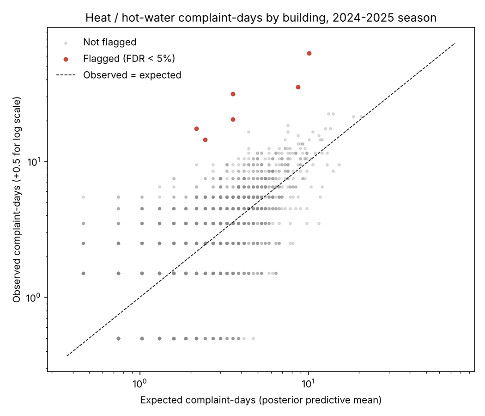

# NYC Heat & Hot-Water Complaint Anomalies

[](https://github.com/jarvissimms12/nyc-heat-anomalies/actions/workflows/tests.yml)


Finding NYC buildings whose heat and hot-water complaints in a heating season are
far above what their own history predicts, using public NYC 311 data.

**Author:** Jarvis Simms · [LinkedIn](https://www.linkedin.com/in/jarvis-simms-846062136/) · [GitHub](https://github.com/jarvissimms12)



*Example output from the test simulation (2,000 synthetic buildings, 8 with planted
spikes). Each point is a building. Red points are buildings flagged at a 5% false
discovery rate. Run the quick start below to produce the same chart from live 311 data.*

**Why it matters:** NYC law requires landlords to provide heat from October 1 to
May 31. A sudden, lasting rise in a building's complaints can mean a failing
boiler, a change in ownership or management, or deliberate neglect. Each of these
can be worth a closer look for tenant protection or enforcement. This pipeline
produces a ranked, uncertainty-aware list of buildings for further review.

## Pipeline

| Step | File | What it does |
|---|---|---|
| Extract | `etl.py` | Pages through the NYC Open Data SODA API (311 dataset `erm2-nwe9`) with retries and stable ordering |
| Validate | `etl.py` | Runs 7 reliability checks; drops records only when they can't be used at building level, otherwise flags them; logs every check to `data_quality_log` |
| Load | `sql/schema.sql` | SQLite schema with an index on `(bbl, created_date)` |
| Aggregate | `sql/building_season_counts.sql` | Complaint-days per building per heating season (SQL CTE + date logic) |
| Model | `analysis.py` | Empirical-Bayes Gamma-Poisson model, 90% prediction intervals, Benjamini-Hochberg FDR control |
| Test | `tests/test_pipeline.py` | 5 pytest tests on synthetic data: validation rules, BBL parsing, BH correctness, recovery of planted anomalies, end-to-end SQL |

## Quick start

```bash
pip install -r requirements.txt

# 1. Pull four heating seasons (2021-22 through 2024-25)
python etl.py --start 2021-10-01 --end 2025-06-01 --db heat.db

# 2. Score the 2024-25 season against the three prior seasons
python analysis.py --db heat.db --target-season 2024 --baseline-seasons 3 --fdr 0.05

# 3. Tests (no network needed)
pytest -q
```

Outputs go to `output/`: a score for every building, the flagged subset, and
an observed-vs-expected chart.

## Project layout

```
nyc-heat-anomalies/
├── etl.py                          # extract from SODA API, validate, load to SQLite
├── analysis.py                     # empirical-Bayes scoring, FDR control, chart
├── sql/
│   ├── schema.sql                  # tables + audit log
│   └── building_season_counts.sql  # complaint-days per building per season
├── tests/test_pipeline.py          # offline tests on synthetic data
├── docs/                           # example output
└── .github/workflows/tests.yml     # runs the tests on every push
```

## Key design decisions

**Complaint-days, not complaints.** One outage in a 200-unit building can
produce 40 calls in one day. Counting distinct days with at least one complaint
measures how *often* a building has a problem, and keeps large buildings from
dominating simply because they have more tenants. Raw counts are kept as well.

**Shrinkage instead of raw ratios.** A building going from 1 to 4 complaint-days
is a "4x increase", but that is weak evidence. The Gamma-Poisson model pulls
low-history buildings toward the citywide rate, so a building is flagged only
when the evidence is strong.

**False discovery rate, not per-test significance.** With ~50,000 buildings
tested at alpha = 0.05, about 2,500 would be flagged by chance alone.
Benjamini-Hochberg keeps the expected share of false leads among flagged
buildings at or below the chosen level (5% by default).

**Flag, don't silently drop.** Records with impossible close dates or bad
coordinates still represent a real complaint at a known building, so they are
kept and flagged. Every decision is written to `data_quality_log` so an
analysis can be audited and defended.

## Limitations

- **Complaints measure reporting, not conditions.** Reporting rates differ by
  neighborhood, language, and tenant awareness of 311. A flag means "unusual for
  this building", not proof of a violation. It should be checked against HPD
  violations and inspection records.
- **Selection.** Only buildings with at least one complaint in the window appear
  in 311 data. Buildings with no complaints are absent, which slightly lowers the
  estimated citywide prior.
- **Poisson within building.** Problems that persist (a broken boiler for six
  weeks) create correlated days. The model treats days within a season as
  independent, which can understate uncertainty. A negative-binomial
  likelihood within building is a natural extension.
- **No building-size adjustment.** Joining NYC PLUTO (residential units by BBL)
  would allow per-unit rates and a better-informed prior.
- **Stationarity.** The baseline assumes a building's underlying rate is
  stable across baseline seasons. Citywide shocks (for example, an unusually
  cold winter) shift every building and could be handled with a season-level
  multiplier.
